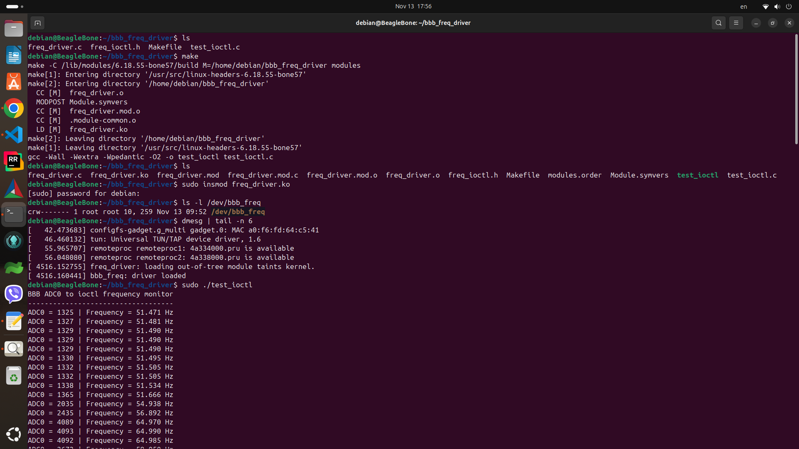
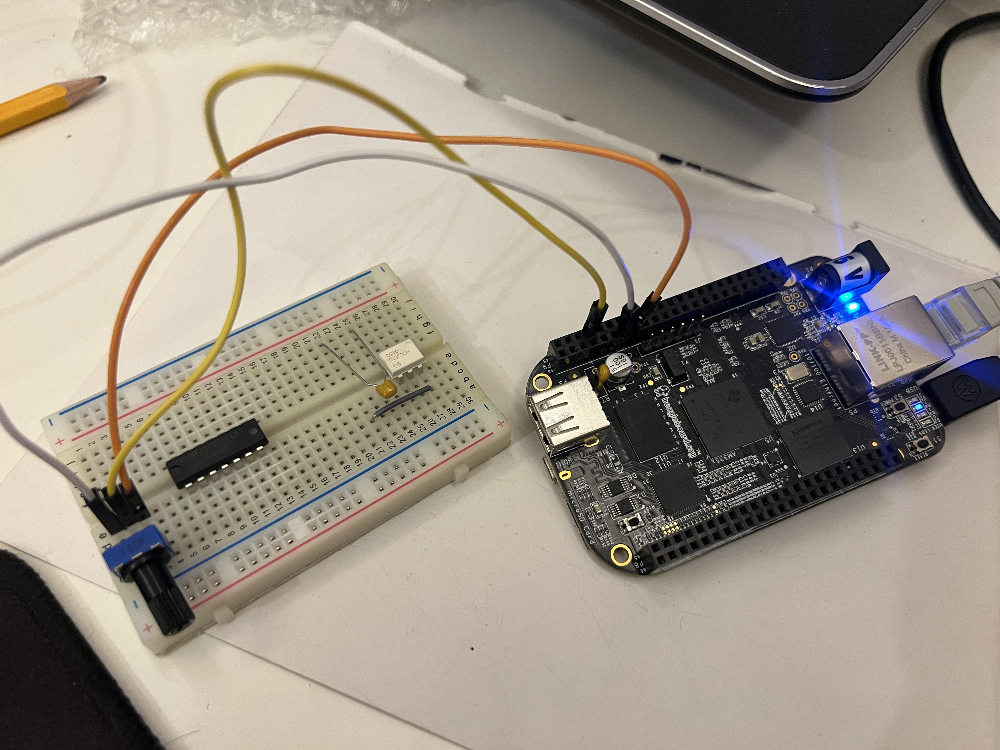
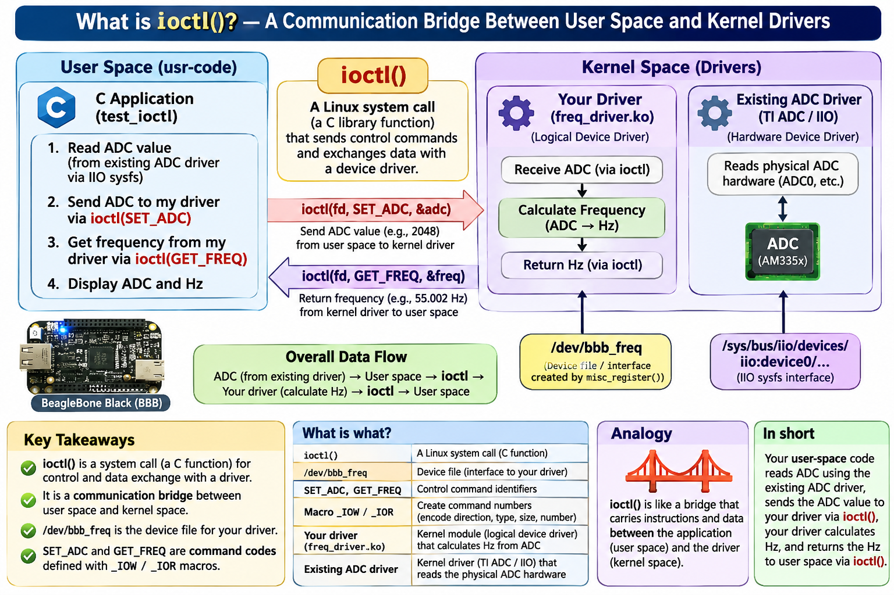
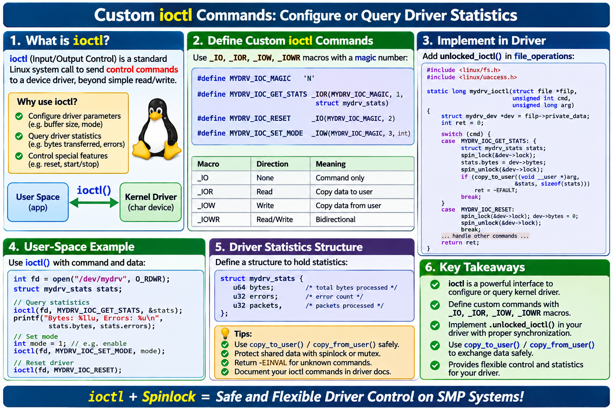

# BeagleBone Black ADC ioctl Frequency Driver

A Linux **miscellaneous character device driver** for the BeagleBone Black (TI AM335x). The project reads an ADC sample through Linux's existing **Industrial I/O (IIO)** interface, sends that sample to a custom kernel module using `ioctl()`, and retrieves a calculated **45–65 Hz** frequency value. It is intended as a hands-on embedded Linux learning project and a foundation for future web telemetry and Yocto integration.

> **Project status:** The ADC + C userspace application + custom `ioctl()` driver have been tested on a BeagleBone Black. **Web telemetry and Yocto packaging are planned**, not part of the verified implementation described here.

Test Result:
ioctl_ADC


ADC POT, 60k. ioctl_ADC_POT



## Architecture

```text
10 kΩ potentiometer (0–1.8 V)
          |
          v
BBB P9_39 / AIN0 / ADC channel 0
          |
          v
Existing TI AM335x ADC driver (Linux IIO)
          |
          v
/sys/bus/iio/devices/iio:device0/in_voltage0_raw
          |
          v
C userspace program: test_ioctl
          | ioctl(SET_ADC, &raw)
          v
/dev/bbb_freq  <----  freq_driver.ko (custom kernel module)
          |                stores ADC and calculates frequency
          | ioctl(GET_FREQ, &frequency_mhz)
          v
C userspace program prints ADC count and frequency
          |
          v
[Planned] HTTP/JSON web telemetry dashboard
```

**Terminology:** `freq_driver.ko` is a loadable **kernel module** containing the logical character-device driver. `/dev/bbb_freq` is its **device node**, registered by `misc_register()`. It is **not** a Device Tree node. The physical ADC is supported by a separate, existing TI AM335x Linux driver.

## Tested environment

- **Board:** BeagleBone Black (AM335x)
- **Kernel:** `6.18.55-bone57`
- **Compiler:** GCC 14.2.0
- **Build tool:** GNU Make 4.4.1
- **ADC:** TI AM335x IIO driver, `iio:device0`, channel 0
- **ADC input resolution:** 12 bits (raw count 0–4095)

Other kernel versions or Linux distributions may have different ADC paths and require matching kernel headers.

## Hardware wiring (potentiometer test)

For the **initial 45–65 Hz simulation**, use a 10 kΩ potentiometer powered by the BBB's **1.8 V analog supply**:

| Potentiometer terminal  | BeagleBone Black header | Purpose                        |
| ---                     | ---                     | ---                            |
| Outer terminal 1        | **P9_32**               | VDD_ADC, 1.8 V analog supply   |
| Middle terminal (wiper) | **P9_39**               | AIN0, ADC channel 0            |
| Outer terminal 2        | **P9_34**               | GNDA_ADC, analog ground        |

**Electrical safety:** Power off before changing connections. **Never connect 3.3 V directly to the ADC**: the BBB analog inputs are rated for a maximum of **1.8 V**. Verify pin numbering and wiring before powering on. The potentiometer test does **not** need a voltage divider because it is supplied from 1.8 V. If a future transmitter delivers 0–3.3 V DC, use an appropriately designed divider or signal conditioner and **revise the conversion calibration**; do not reuse this potentiometer's raw-to-frequency scaling without validation.

The project interprets a **DC voltage that represents frequency**; it does not measure the period of an oscillating 45–65 Hz waveform.

## Repository files

```text
.
├── Makefile          # Builds kernel module and userspace application
├── freq_driver.c     # Custom Linux misc character-device driver
├── freq_ioctl.h      # Shared ioctl ABI definitions
├── test_ioctl.c      # IIO ADC reader and ioctl test application
└── README.md
```

Generated outputs include `freq_driver.ko`, `freq_driver.o`, and `test_ioctl`. These should generally not be committed to Git.

## Frequency conversion

The potentiometer maps the ADC's full raw range linearly onto 45–65 Hz:

```text
frequency_Hz = 45 + (ADC_raw * 20 / 4095)
```

The kernel performs the calculation using **integer millihertz**:

```c
frequency_mhz = 45000U + (adc_raw * 20000U) / 4095U;
```

For example:

| ADC raw count | Approximate frequency |
| ---:          | ---:                  |
| 0             | 45.000 Hz             |
| 1024          | 50.001 Hz             |
| 2048          | 55.002 Hz             |
| 3071          | 59.998 Hz             |
| 4095          | 65.000 Hz             |

The second formula uses integer truncation, so displayed results may differ slightly from a floating-point result.

## Build prerequisites

The BBB needs a native compiler, Make, and kernel headers/build files matching **the running kernel**.

```bash
uname -r
gcc --version
make --version
ls -ld /lib/modules/$(uname -r)/build
```

The last command must resolve to a usable kernel build directory. On the tested board it points to `/usr/src/linux-headers-6.18.55-bone57`.

## Clone and build

```bash
git clone https://github.com/Natsagnyam/beaglebone-black-adc-ioctl-driver.git
cd beaglebone-black-adc-ioctl-driver

# Build both the module and the userspace application.
make

# Verify the outputs.
ls -lh freq_driver.ko test_ioctl
```

> The repository must first contain the source files and Makefile. If you already built the project in `~/bbb_freq_driver`, use that directory directly until you push its contents to GitHub.

Make targets (with the combined Makefile):

| Command               | Action                            |
| ---                   | ---                               |
| `make` / `make all`   | Build the module and application  |
| `make module`         | Build only `freq_driver.ko`       |
| `make app`            | Build only `test_ioctl`           |
| `make clean`          | Remove build outputs              |
| `make help`           | Show targets                      |

**Makefile note:** Recipe commands require real tab characters. The kernel module must be built using the kernel build system; the userspace executable is built with GCC.

## Test 1 — Verify the existing ADC driver

```bash
# Confirm which IIO device is present.
cat /sys/bus/iio/devices/iio:device0/name

# On the tested system this prints: TI-am335x-adc.0.auto

# Read AIN0 once.
cat /sys/bus/iio/devices/iio:device0/in_voltage0_raw

# Read AIN0 repeatedly; rotate the potentiometer.
while true; do
    cat /sys/bus/iio/devices/iio:device0/in_voltage0_raw
    sleep 0.5
done
```

Rotate the potentiometer from end to end. The count should change from near **0** to near **4095**. The tested setup produced approximately **1–4093**. Press **Ctrl+C** to stop the loop; Ctrl+Z only suspends it.

If the path differs, inspect `/sys/bus/iio/devices/` and identify the TI ADC device before changing the application.

## Test 2 — Load the custom driver

```bash
# From the project directory:
sudo insmod ./freq_driver.ko

# Confirm the module is loaded.
lsmod | grep freq_driver

# Confirm the registered character-device node exists.
ls -l /dev/bbb_freq

# Inspect recent kernel messages.
sudo dmesg | tail -n 10
```

Expected kernel message:

```text
bbb_freq: driver loaded
```

A device listing such as `crw------- 1 root root 10, 259 ... /dev/bbb_freq` identifies a **character device**. The minor number can differ between loads.

If `insmod` says **`File exists`**, the module is normally already loaded; check `lsmod` rather than inserting it again. An out-of-tree-module *taint* notice is also expected for locally built external modules.

## Test 3 — Test ioctl using a fixed ADC sample

The original fixed-value version of `test_ioctl.c` sent `2048` using `SET_ADC` and requested the result using `GET_FREQ`:

```c
uint32_t adc_value = 2048U;
uint32_t frequency_mhz = 0U;

ioctl(fd, SET_ADC, &adc_value);             /* Userspace -> kernel */
ioctl(fd, GET_FREQ, &frequency_mhz);        /* Kernel -> userspace */
```

Expected output:

```text
ADC raw value = 2048
Frequency = 55.002 Hz
```

This fixed-value test is illustrative if the repository currently contains the **live** version of `test_ioctl.c`; the live version reads the potentiometer instead of sending a constant.

## Test 4 — Live potentiometer + ioctl end-to-end test

Build the current userspace application and run it:

```bash
make app
sudo ./test_ioctl
```

While the application is running, rotate the POT. Example output from the tested hardware:

```text
BBB ADC0 to ioctl frequency monitor
-----------------------------------
ADC0 =    3 | Frequency = 45.014 Hz
ADC0 =  776 | Frequency = 48.789 Hz
ADC0 = 1880 | Frequency = 54.181 Hz
ADC0 = 3190 | Frequency = 60.579 Hz
ADC0 = 4092 | Frequency = 64.985 Hz
ADC0 = 4093 | Frequency = 64.990 Hz
```

These readings demonstrate the application reading IIO sysfs, passing the count through `ioctl(SET_ADC)`, and retrieving the frequency using `ioctl(GET_FREQ)`. Press **Ctrl+C** to stop.

### ioctl command definitions

The shared header defines two distinct commands (names may differ in older local copies of the project):

```c
#define FREQ_IOCTL_MAGIC                        'F'
#define FREQ_IOCTL_CMD_NUMBER_SET_ADC           1U
#define FREQ_IOCTL_CMD_NUMBER_GET_FREQ          2U

#define FREQ_IOCTL_SET_ADC \
    _IOW(FREQ_IOCTL_MAGIC, FREQ_IOCTL_CMD_NUMBER_SET_ADC, __u32)

#define FREQ_IOCTL_GET_FREQ \
    _IOR(FREQ_IOCTL_MAGIC, FREQ_IOCTL_CMD_NUMBER_GET_FREQ, __u32)
```

- `_IOW` encodes a **userspace-to-kernel** data transfer.
- `_IOR` encodes a **kernel-to-userspace** data transfer.
- The command number (`1` or `2`) identifies an operation; it is **not** the ADC value.
- `__u32` specifies an unsigned 32-bit value.

.png)






**Compatibility:** If your existing files still use `SET_ADC` / `GET_FREQ`, either keep those names in all source files or consistently update **both** `freq_driver.c` and `test_ioctl.c` to `FREQ_IOCTL_SET_ADC` / `FREQ_IOCTL_GET_FREQ` before rebuilding and reloading.

## Rebuild, reload, and unload

Changing a `.c` file does **not** replace a module already running in the kernel.

```bash
# Stop the userspace program first (Ctrl+C).

# Build the updated kernel module.
make module

# Remove the old module if loaded.
sudo rmmod freq_driver

# Load the new module.
sudo insmod ./freq_driver.ko

# Check status.
lsmod | grep freq_driver
```

To unload the module after testing:

```bash
sudo rmmod freq_driver
```

If `rmmod` says the module is in use, stop any process holding `/dev/bbb_freq` open before retrying.

## Troubleshooting

| Symptom                                  | Likely explanation / action                                                            |
| ---                                      | ---                                                                                    |
| `No rule to make target 'freq_driver.o'` | Confirm the filename is exactly `freq_driver.c`, not `nano freq_driver.c`              |
| `config-pin: command not found`          | Your image may already enable the ADC; check the IIO device first                      |
| `insmod: ... File exists`                | Module is already loaded; inspect `lsmod`                                              |
| `Cannot open /dev/bbb_freq`              | Load the module and check device permissions; use `sudo` for this root-only prototype  |
| ADC readings do not change               | Check POT wiring, AIN0 path, and analog ground                                         |
| Values stop at ~4095                     | This is the expected maximum of a 12-bit ADC                                           |
| `GET_FREQ` or `SET_ADC` fails            | Verify that the userspace and kernel headers use identical ioctl command definitions   |
| `make` fails due to kernel headers       | Verify `/lib/modules/$(uname -r)/build` matches the running kernel                     |

## Limitations and next steps

- The current logical driver **does not acquire hardware samples directly**; userspace reads the pre-existing IIO ADC driver.
- The 45–65 Hz value is **calculated from a DC voltage**, not measured as the frequency of an alternating waveform.
- The `SET_ADC` / `GET_FREQ` pair shares one stored ADC value across callers; concurrent applications can interleave transactions. A future design should make reading and conversion atomic or define per-open state.
- The simple prototype uses a root-only device. Production deployments should define appropriate access controls and service permissions.
- **Planned:** HTTP/JSON telemetry service and live browser gauge.
- **Planned:** Yocto recipes to package the module and userspace application.
- **Possible future enhancement:** Linux IIO consumer API integration for kernel-side ADC acquisition, where appropriate.

## Publishing the source to GitHub

From your existing BBB project directory (after adding this README):

```bash
cd ~/bbb_freq_driver

# Initialize Git only if this directory is not already a repository.
git init

git add Makefile freq_driver.c freq_ioctl.h test_ioctl.c README.md
git commit -m "Initial BBB ADC ioctl driver and live test"

git branch -M main
# git remote add origin https://github.com/Natsagnyam/beaglebone-black-adc-ioctl-driver.git
git remote add origin git@github.com:Natsagnyam/beaglebone-black-adc-ioctl-driver.git
git push -u origin main
```

If `origin` already exists, use `git remote -v` and update it instead of adding a duplicate. A `.gitignore` is recommended to exclude generated `.ko`, `.o`, `.mod*`, `Module.symvers`, `modules.order`, and compiled executables.

## License
Author
Natsagnyam Namkhai
This project is licensed under the **GNU General Public License v2.0 only (GPL-2.0-only)**.

You may use, study, modify, and redistribute the software under the terms of the GPL-2.0 license.

See the [LICENSE](LICENSE) file for the complete license terms.