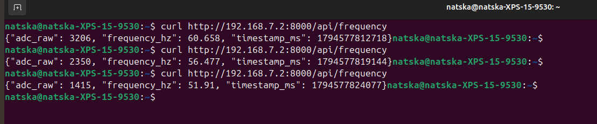
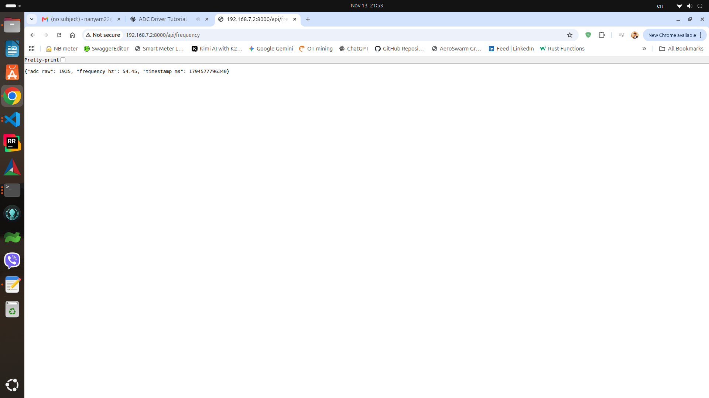

# Next steps: BBB live web telemetry and Yocto packaging

This addition is intended for the existing repository:
`https://github.com/Natsagnyam/beaglebone-black-adc-ioctl-driver`

It assumes `freq_driver.ko` supports `_IOW('F', 1, __u32)` for `SET_ADC`
and `_IOR('F', 2, __u32)` for `GET_FREQ`. The actual command names may
vary; the encoded numbers must remain compatible. The POT is wired
P9_32 (1.8 V) -> POT outer, P9_39 (AIN0) -> POT wiper, and
P9_34 (analog ground) -> POT other outer.

Test Result:
test_ADC_telemetry ioctl_ADC

ADC_telemetry

## Part A: Run the web dashboard on the current Debian BBB

1. Copy `web/dashboard.py` and `web/index.html` into your existing
   `~/bbb_freq_driver/web/` directory.
2. Check that the kernel module is loaded: `lsmod | grep freq_driver`.
   If it is not loaded, from `~/bbb_freq_driver`, run
   `sudo insmod ./freq_driver.ko`.
3. Check the device node: `ls -l /dev/bbb_freq`.
4. Start the web dashboard:
   `cd ~/bbb_freq_driver/web && sudo python3 dashboard.py`
5. In another terminal, confirm the JSON endpoint:
   `curl http://127.0.0.1:8000/api/frequency`
6. From your computer or phone on the trusted LAN, visit
   `http://192.168.68.104:8000/` (check `hostname -I` because DHCP can
   change the IP address).
7. Turn the potentiometer. The gauge should move from ~45 to ~65 Hz.
8. Stop with Ctrl+C. Stop the existing `test_ioctl` while using the web
   server: the module stores only one global ADC value and independent
   clients can interleave SET_ADC and GET_FREQ calls.

This is an HTTP learning server without authentication or TLS. It runs as
root only because the current character device is mode 0600. Use on a
trusted, isolated LAN; do not forward port 8000 to the public Internet.

## Part B: Package the module and dashboard in Yocto

The provided layer is a **starting template**; it has NOT been built in
an actual Yocto environment. Yocto builds require your chosen branch,
machine configuration, BSP and kernel providers to be compatible.

1. On a Yocto build host, copy `yocto/meta-bbb-freq` into your Yocto
   workspace as `meta-bbb-freq`.
2. Copy your repository's `freq_driver.c`, `freq_ioctl.h`, and `LICENSE`
   to `meta-bbb-freq/recipes-kernel/bbb-freq/files/`.
3. Copy `web/dashboard.py`, `web/index.html`, and the repository's
   `LICENSE` into
   `meta-bbb-freq/recipes-apps/bbb-freq-dashboard/files/`.
4. From each `files/` directory, run `md5sum LICENSE`. Replace
   `REPLACE_WITH_REAL_MD5` in the corresponding `.bb` recipe with its
   calculated hexadecimal checksum.
5. Ensure the top-level Yocto layer series in `conf/layer.conf` matches
   your selected Yocto release; adjust `LAYERSERIES_COMPAT` as needed.
6. Initialize your build environment, e.g. `source oe-init-build-env`.
7. Add your layer: `bitbake-layers add-layer ../meta-bbb-freq` (adjust
   path to your workspace).
8. Build both recipes separately first:
   `bitbake bbb-freq bbb-freq-dashboard`.
9. In `conf/local.conf`, add:
   `IMAGE_INSTALL:append = " bbb-freq-dashboard"`.
   The dashboard recipe depends on the auto-split `kernel-module-freq-driver`
   package; the kernel recipe configures autoload.
10. Build your actual image recipe, e.g. `bitbake core-image-base` if that
    is your intended image and machine.
11. Boot the **new matching Yocto image**, then inspect:
    `uname -r`, `lsmod | grep freq_driver`,
    `ls -l /dev/bbb_freq`,
    `systemctl status bbb-freq-dashboard`,
    `journalctl -u bbb-freq-dashboard -n 30`,
    `curl http://127.0.0.1:8000/api/frequency`.

Do not assume that a kernel module built against a Yocto kernel will
load on the current Debian `6.18.55-bone57` kernel.

**No new Device Tree node is necessary** for this custom logical driver.
The TI AM335x ADC hardware driver continues to use the existing IIO
interface. If a future module directly consumes ADC channels using
IIO or supports a new hardware peripheral, the device-tree binding and
runtime driver architecture may need to change.

## Files in this addition

- `web/dashboard.py` - ADC reader, ioctl client, and HTTP JSON service.
- `web/index.html` - self-contained browser gauge.
- `yocto/meta-bbb-freq/conf/layer.conf` - custom Yocto layer metadata.
- `yocto/meta-bbb-freq/recipes-kernel/bbb-freq/bbb-freq_1.0.bb` - module recipe.
- `yocto/meta-bbb-freq/recipes-kernel/bbb-freq/files/Makefile` - Yocto Kbuild Makefile.
- `yocto/meta-bbb-freq/recipes-apps/bbb-freq-dashboard/bbb-freq-dashboard_1.0.bb` - service recipe.
- `yocto/meta-bbb-freq/recipes-apps/bbb-freq-dashboard/files/bbb-freq-dashboard.service` - systemd unit.
